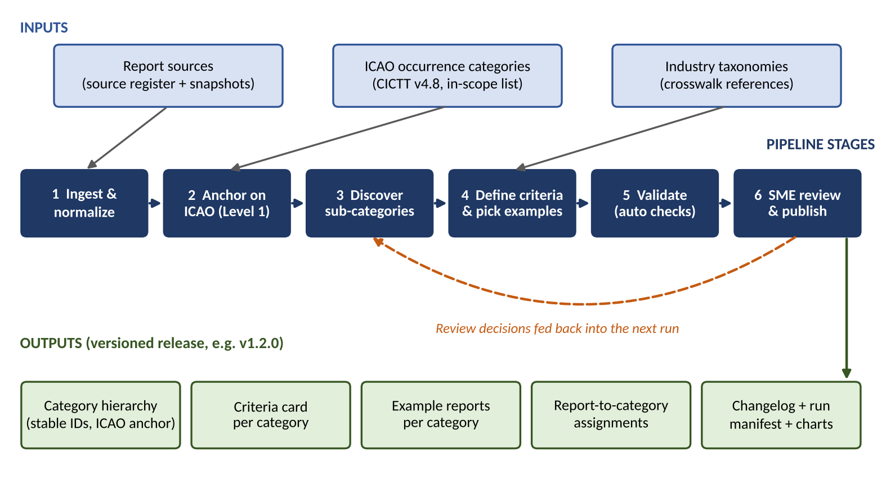
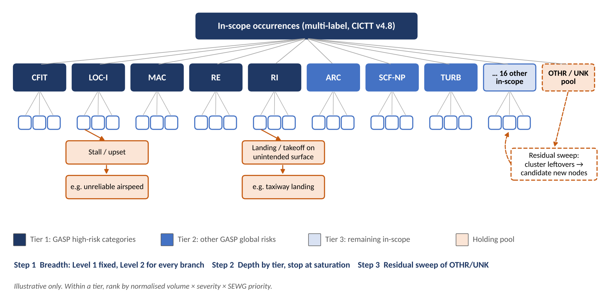

| Item | Detail |
|---|---|
| **User story** | 311617 – Taxonomy discovery pipeline requirements |
| **Parent** | #311596 – 4. Taxonomy discovery pipeline (Active) |
| **Owner** | Bhairav Mehta (US) |
| **Status** | Draft v2 for team review – research-refined. Decisions needed are marked DECISION |
| **Builds on** | US 311610 ICAO taxonomy review (B1) · US 311613 industry taxonomy survey (B4) · data-source review · external research (Section 14) |
| **Date** | October 20, 2026 |

# 1. Summary

The taxonomy discovery pipeline reads safety reports and organizes them into a tree of risk categories. The top of the tree (Level 1) is fixed to the ICAO/CICTT occurrence categories, such as RI, RE and LOC-I. The pipeline discovers the sub-categories underneath from the report text, writes clear criteria for each one and attaches example reports. Safety SMEs review every change before it is published as a new version. The result feeds the SEWG top-down decomposition charts, like the RI → landing/takeoff on unintended surfaces pilot.

This document defines the pipeline’s inputs, outputs, source handling, rerun behavior and review handoff. It also proposes the in-scope ICAO categories for team agreement and answers Cedar’s question on build order. Version 2 adds findings from external research on ICAO/CICTT, public data sources, automated taxonomy methods and AI assurance.

## What this story asked for, and where it is covered

| Ask | Section |
|---|---|
| Inputs: report sources, ICAO definitions, industry taxonomies | 3. Inputs |
| Outputs: versioned hierarchy, criteria and example reports per category | 4. Outputs |
| How sources are handled | 5. Source handling |
| How reruns behave | 6. Rerun behavior |
| How work is handed off for review | 7. Review handoff |
| Team agreement on in-scope ICAO categories | 9. ICAO scope (DECISION) |
| Cedar (Oct 8): include a visual | Figures 1 and 2 |
| Cedar (Oct 12): most-likely path first, or entire tree? | 10. Build strategy (DECISION) |
| Draw on ICAO, taxonomy and data-source review findings | 3, 5, 9 and 14 |

# 2. Pipeline at a glance

| Stage | What it does |
|---|---|
| **1 Ingest & normalize** | Pull a dated snapshot from each registered source, convert it to one common format and link duplicate events. |
| **2 Anchor on ICAO** | Assign each report to one or more in-scope CICTT categories (multi-label). These form the fixed Level 1. |
| **3 Discover sub-categories** | Group similar reports under each Level 1 category and propose named sub-categories (Level 2, 3, …). Leftovers go to the OTHR/UNK pool. |
| **4 Define criteria & examples** | Write a criteria card for each proposed category, add facets and crosswalks, and pick example reports. |
| **5 Validate** | Run automatic checks: coverage, minimum size, sibling overlap, stability vs. last version. |
| **6 SME review & publish** | Safety SMEs approve, edit, merge, split or reject. Approved changes are published as a new version. |

# 3. Inputs

Priority: Must = needed for the first release; Should = planned, can follow.

| ID | Requirement | Priority |
|---|---|---|
| **IN-1** | Report sources. Every source is listed in a source register: name, owner, system, record count, date range, fields used, access rules, licence, data classification, extract date and refresh cadence. Boeing internal sources come from the data-source review; public sources are in the table below. | Must |
| **IN-2** | ICAO definitions. CICTT Aviation Occurrence Categories v4.8 (May 2021), 36 codes, stored as a machine-readable file: code, name, definition, includes, excludes and “code both” rules. Confirm against the official CICTT PDF before baselining. | Must |
| **IN-3** | Industry taxonomies, each pinned to a version and used as facets or crosswalks (table below), not as extra branches. | Must |
| **IN-4** | Priority references: ICAO GASP 2026–2028 (Doc 10004) high-risk categories, the CAST safety enhancement portfolio (tagged by CICTT code) and SEWG priorities. Used to rank branches. | Must |
| **IN-5** | Minimum report fields: report ID, source, event date, aircraft model, phase of flight (if available), narrative text and any existing category codes. | Must |
| **IN-6** | Run configuration file: in-scope list, depth limit, thresholds, model and prompt versions, random seed and taxonomy versions. Every run records the configuration it used. | Must |
| **IN-7** | Existing codes in the data (e.g., CICTT codes in NTSB data, ASRS anomaly codes) are used to check the pipeline’s results, not treated as ground truth. | Should |

## Taxonomies: role in the pipeline

| Taxonomy | Role | Notes |
|---|---|---|
| **CICTT Occurrence Categories v4.8** | Level 1 (primary) | Global standard used by ICAO, CAST, NTSB, EASA and the Boeing Statistical Summary. Multi-label. |
| **CICTT Phase of Flight v1.3** | Facet | Tag each report with phase (taxi, takeoff, approach, landing, …). Not a branch. |
| **ECCAIRS / ADREP events** | Crosswalk | Fine-grained event list; useful wording for Level 2+. Version it separately (EASA publishes release diffs). |
| **ATA iSpec 2200 chapters** | Facet | Aircraft system for SCF-NP / SCF-PP children. Paid licence from Airlines for America – confirm Boeing’s licence. |
| **HFACS** | Facet | Contributing human factors (“why”), kept separate because a CICTT category is not a cause. |
| **EASA ERCS Key Risk Areas** | Facet | Outcome / severity view; feeds the severity term in branch ranking. |
| **NASA ASRS anomaly codes** | Crosswalk | Weak labels for ASRS reports only. |
| **IATA IDX** | Optional | Contributor-only access; taxonomy not published. |

## Public report sources

| Source | Access | What to watch |
|---|---|---|
| **NTSB CAROL / avall** | Free; monthly database with weekly updates; records from 1962 | Accidents and selected incidents; long narratives and probable cause. |
| **NASA ASRS** | Free web query; 10,000 records per export; monthly updates; no official API | Voluntary, mostly pilot reports. Counts are a lower bound, not prevalence. Overlaps with airline ASAP programs. |
| **FAA AIDS** | Bulk download via ASIAS; incidents since 1978 | Incidents only; short narratives. |
| **FAA SDRS** | Web database | Maintenance defect reports; known quality and reporting-rate gaps between operators. |
| **TSB Canada** | Monthly CSV from 1995 with data dictionary | Some fields withheld; text may be in French. |
| **ATSB** | Dashboard from 2003; 200-row download cap | Bulk use needs a data request. |

# 4. Outputs

| ID | Requirement | Priority |
|---|---|---|
| **OUT-1** | Versioned category hierarchy. Each category has a permanent ID, name, level, parent, ICAO anchor code(s), status (Proposed / Approved / Retired), the version it was introduced in, and the CICTT and ECCAIRS versions it was checked against. | Must |
| **OUT-2** | Criteria card for every category: a 1–2 sentence definition; “include if” and “exclude if / don’t confuse with” rules; CICTT “code both” rules; key terms; Phase-of-Flight and ATA facets; mapping to other taxonomies; and a note that the category describes what happened, not the cause. | Must |
| **OUT-3** | Example reports for every category: 3–5 typical and 1–2 borderline reports, referenced by report ID with a one-line reason each, drawn from at least 2 sources where possible. | Must |
| **OUT-4** | Report-to-category assignments with a confidence score. Multi-label, following CICTT rules: F-POST is never used alone; OTHR and UNK are not combined with other categories. | Must |
| **OUT-5** | Changelog and run manifest in the CICTT style: date, version, category, change, plus migration notes for historical data (like CICTT’s note to re-code old “other” bird strikes as BIRD). Also a machine-readable diff in the ECCAIRS style: added, retired, merged, split and changed criteria. | Must |
| **OUT-6** | Visuals: one decomposition chart per Level 1 category, in the SEWG chart style. | Should |
| **OUT-7** | Formats: JSON/CSV for the pipeline and an Excel/PDF review pack for people. Both saved to the team file share by version. | Must |

## Version numbers

| Change | Example | What triggers it |
|---|---|---|
| **Major** | 1.0.0 → 2.0.0 | Level 1 changes: ICAO scope added or removed. |
| **Minor** | 1.2.0 → 1.3.0 | A category is added, merged, split or retired, or an external anchor changes (e.g., new CICTT or ECCAIRS release). An anchor change also triggers re-checking the crosswalks. |
| **Patch** | 1.2.0 → 1.2.1 | Wording, criteria text or example reports change only. |

# 5. Source handling

| ID | Requirement | Priority |
|---|---|---|
| **SRC-1** | Read-only. The pipeline never changes source systems. | Must |
| **SRC-2** | Snapshots. Each run uses a dated snapshot of each source with a cut-off date and checksum so it can be repeated exactly. | Must |
| **SRC-3** | One common format. All sources are converted to the fields in IN-5 before analysis. | Must |
| **SRC-4** | Duplicates. Link the same event across sources (e.g., NTSB ↔ FAA AIDS, ASRS ↔ airline ASAP reports) as one event, not dropped. Counts use events, not reports. | Must |
| **SRC-5** | Short narratives. Flag reports below a minimum length as low-information. They can be assigned to categories but cannot define new ones. | Must |
| **SRC-6** | Fair counting. ASRS and other voluntary-report counts are not prevalence. Normalize volume by source before using it in branch ranking. | Must |
| **SRC-7** | Access, licence and security. Data stays in the approved environment and follows each source’s access rules, licence and classification. Review packs quote report IDs and short approved excerpts only. | Must |
| **SRC-8** | Traceability. Each category shows how many reports came from each source, so a category driven by one source is easy to spot. | Should |
| **SRC-9** | Language. Non-English narratives (e.g., French TSB text) are detected and either translated with the translation logged or set aside. | Should |
| **SRC-10** | Out-of-scope reports go to a separate pool, not deleted, so a future scope change is a re-label rather than a re-load. | Should |
| **SRC-11** | New sources. Adding a source means adding it to the register, mapping its fields and running an impact check before a full rerun. | Should |

# 6. Rerun behavior

Reruns must be predictable: the same inputs give the same tree, and approved work is never silently changed.

| ID | Requirement | Priority |
|---|---|---|
| **RR-1** | Repeatable. Same snapshots and configuration produce the same output. Pinned model versions and fixed seeds are required, and cached model responses are the record: a rerun reads from the cache instead of calling the model again. | Must |
| **RR-2** | Stable IDs. Approved categories keep their IDs. New groups of reports are matched to existing categories first; a new category is proposed only when nothing matches. | Must |
| **RR-3** | Approved means locked. A rerun can propose changes to an approved category but cannot apply them without SME review. | Must |
| **RR-4** | Two modes. Incremental: new reports are assigned to the current tree and poor fits collect in the OTHR/UNK pool, which triggers discovery once it passes a threshold. Full: rediscover from scratch and compare with the current version. | Must |
| **RR-5** | Change report. Every run produces a diff against the last published version. | Must |
| **RR-6** | Stability measures: the share of unchanged reports that keep the same category, plus a cluster-level adjusted Rand index. Flag the run if either falls below target. | Should |
| **RR-7** | Restartable. Each stage saves a checkpoint, so a failed run resumes from the last completed stage. | Should |
| **RR-8** | Triggers. Full rerun on any anchor change (CICTT, ECCAIRS, in-scope list) or new source; incremental runs on a set schedule (cadence to be agreed). | Should |

# 7. Review handoff

Every change to the tree goes through people before it is published. The pipeline prepares the work; SMEs decide.

| ID | Requirement | Priority |
|---|---|---|
| **HO-1** | Review pack per run: changelog, each new or changed category with its criteria card and examples, quality metrics and open questions. | Must |
| **HO-2** | Manageable batches: no more than about 25 categories per pack, ordered by branch priority (Tier 1 first). Sibling categories go in the same pack so overlaps are visible. | Must |
| **HO-3** | One decision per category: Approve, Edit, Merge, Split, Reject or Defer, with a comment. Captured in a structured review sheet (Excel or SharePoint list) that the pipeline reads back. | Must |
| **HO-4** | Decisions feed the next run: approved categories are locked, rejected names are not proposed again, and edits become the new criteria. | Must |
| **HO-5** | Status flow: Proposed → In review → Approved → Published, and Retired when merged or removed. | Must |
| **HO-6** | Audit trail: reviewer, decision, reason, date and version, kept with each release. | Must |

## Roles

| Role | Responsibility |
|---|---|
| **Pipeline owner (data science)** | Runs the pipeline, prepares the review pack and applies the decisions. |
| **Category SMEs (one per Level 1 area)** | Review categories in their area and decide on each one. |
| **Taxonomy owner (SEWG lead)** | Resolves disagreements, approves major versions and owns the ICAO scope. |

# 8. Validation and acceptance

Proposed targets for the team to confirm. They are starting points and will be tuned after the first run.

| Check | Rule | Proposed target |
|---|---|---|
| **Coverage** | Share of in-scope reports assigned to a category that is not a holding pool | ≥ 90% |
| **Minimum size** | Reports per category (too small creates near-duplicates; too large merges distinct themes) | ≥ 10 |
| **Completeness** | Every category has a criteria card and at least 3 example reports | 100% |
| **Agreement** | Two reviewers independently assign a blind sample to sibling categories. Report raw agreement and Cohen’s kappa per Level 1 branch, next to a human-human baseline on the same sample | Raw ≥ 80% and kappa ≥ 0.61 |
| **Traceability** | Every category traces to one primary ICAO anchor | 100% |
| **Stability** | Unchanged reports keeping the same category between runs (no scope change) | ≥ 95% |
| **Residual pool** | Share of reports left in OTHR/UNK | Falls with each release |

# 9. ICAO categories in scope (DECISION)

Updated proposal for team agreement. The focus is commercial transport aircraft. All 5 GASP global high-risk categories and all 3 other GASP global risks are in scope. Categories written for helicopters, gliders, balloons, aerial work or VFR-only pilots are left out, which matches how CICTT itself describes them.

| Proposal | Codes | Why |
|---|---|---|
| **In scope – full branches (24)** | AMAN, ARC, BIRD, CABIN, CFIT, CTOL, EVAC, F-NI, F-POST, FUEL, GCOL, ICE, LOC-G, LOC-I, MAC, NAV, RAMP, RE, RI, SCF-NP, SCF-PP, TURB, USOS, WSTRW | Directly relevant to commercial airplane design, operation and fleet safety. Includes all 8 GASP global risk categories. |
| **In scope – co-code only (2)** | ATM, MED | Tagged alongside other categories but not built out as branches. ATM is the usual co-code when ATC error causes MAC or RI; MED covers medical events moved out of CABIN in 2013. |
| **Watch list (3)** | ADRM, SEC, WILD | Kept as tagged pools. Promote to branches if SEWG wants an airport or security view. |
| **Holding pools (2)** | OTHR, UNK | Not yet categorized. Source for the residual sweep that finds new categories. |
| **Out of scope (5)** | EXTL, GTOW, LALT, LOLI, UIMC | Written for helicopters, gliders, balloons, aerial work or VFR-only pilots. Reports kept in an out-of-scope pool. |

## Questions for the team

- Do we agree with the 24 full branches?
- ATM and MED as co-code only – agreed?
- ADRM, SEC, WILD on the watch list, or should any become full branches now?
- Is CICTT v4.8 confirmed against the official PDF (owner to check)?

| Team member | Agree? (Y / N) | Comments |
|---|---|---|
|  |  |  |
|  |  |  |
|  |  |  |
|  |  |  |

# 10. Build strategy (DECISION)

Cedar’s open question (Oct 12): should the pipeline build the most likely path first and then expand, or build the entire tree at once?

| Option | Pros | Cons |
|---|---|---|
| **A. Most likely path first (depth-first)** | Fast first result; quickly delivers a SEWG chart like the RI pilot. | CICTT is multi-label, so some reports have no single “most likely path.” Siblings are defined late, causing re-splits and ID churn. Cannot find categories outside the chosen path. |
| **B. Entire tree at once (breadth-first)** | Consistent tree with no overlaps; full coverage view from day one. | Slow; large review load at once; effort spent on low-priority branches. |
| **C. Hybrid – recommended** | Coverage view at the top, deep detail where risk is highest, and a way to find new categories. Fits the stable-ID and locked-approval rules. | Needs agreed tier ranking and a stopping rule (both proposed below). |

## Recommendation: breadth first, depth by risk tier, then sweep the leftovers

- Step 1 – Breadth: Level 1 is fixed to the in-scope CICTT codes (not discovered). Assign every report, multi-label, then discover Level 2 for every branch with the same small budget, so sibling detail is set side by side.
- Step 2 – Depth by tier: Tier 1 = GASP high-risk categories (CFIT, LOC-I, MAC, RE, RI); Tier 2 = other GASP global risks (ARC, SCF-NP, TURB); Tier 3 = the rest. Within a tier, rank by normalized volume × severity × SEWG priority. The RI pilot starts first.
- Stopping rule: stop expanding a branch when about 200 reports in a row add no new category (saturation), or when new categories would fall below the 10-report minimum.
- Step 3 – Residual sweep: cluster everything left in OTHR/UNK and low-confidence assignments to find candidate new categories. This is how emerging issues (e.g., GNSS interference, which ICAO’s Middle East region lists among its top occurrence categories) surface.

## Priority tiers

| Tier | Categories | Basis |
|---|---|---|
| **Tier 1** | CFIT, LOC-I, MAC, RE, RI | ICAO GASP 2026–2028 global high-risk categories |
| **Tier 2** | ARC, SCF-NP, TURB | GASP “other global risk categories”. TURB had the most accidents in the ICAO Safety Reports for 2022 and 2023. |
| **Tier 3** | Remaining 16 in-scope branches | Ranked by normalized volume × severity × SEWG priority |

# 11. Discovery method (stage 3)

Based on published approaches. Exact tools to be confirmed for the approved Boeing environment.

| ID | Requirement | Priority |
|---|---|---|
| **DM-1** | Embeddings: start with an aviation-trained model (e.g., NASA’s SafeAeroBERT, trained on NTSB and ASRS reports) as the baseline, compared with a general model. | Should |
| **DM-2** | Clustering within each branch (e.g., BERTopic/HDBSCAN). Tune minimum cluster size to the 10-report floor: too small gives near-duplicate topics, too large merges distinct ones. | Must |
| **DM-3** | An LLM names each cluster and drafts its criteria card from sample reports (as in Clio and TnT-LLM), always with an “Other” option so reports are not forced into a poor fit. | Must |
| **DM-4** | Process reports in batches against the growing tree and stop at saturation (TopicGPT-style rule, Section 10). | Should |
| **DM-5** | At scale, LLM-assigned labels reviewed by SMEs can train a smaller classifier for routine assignment (TnT-LLM approach), checked against a held-out test set. | Should |
| **DM-6** | Model and prompt registry: every model, prompt and version used is recorded with the run. | Must |

# 12. Governance and AI assurance

The pipeline is offline analysis, not airborne software, so EASA and FAA AI guidance is not binding. Mirroring it still strengthens the case with SEWG:

- Human assistance posture (EASA AI Concept Paper Issue 02, Level 1): the AI proposes, SMEs approve every category.
- Separate training, validation and held-out test samples for agreement and classifier checks.
- Model and prompt registry plus audit trail (DM-6, HO-6).
- Watch EASA’s Proposed Issue 03 of the Concept Paper (consultation closed August 12, 2026); it is not final yet.

# 13. Open items

| Item | Owner | Needed by |
|---|---|---|
| Agree on ICAO scope (Section 9) | Team / SEWG lead | Before first run |
| Agree on build strategy and tiers (Section 10) | Team / SEWG lead | Before first run |
| Confirm CICTT v4.8 against the official PDF | Pipeline owner | Before first run |
| Confirm source list and access from the data-source review | Data owners | Before first run |
| Confirm ATA iSpec 2200 licence for chapter facets | Pipeline owner | Before first run |
| Confirm validation thresholds (Section 8) | Team | After first run |
| Name SME reviewers per Level 1 category | SEWG lead | Before first review |
| Agree on rerun cadence | Team | Before v1.0 |
| Confirm approved compute environment and language-model tools | Pipeline owner | Before first run |

# 14. References

- US 311610 – ICAO Occurrence Category Taxonomy, Team Reference (B1). US 311613 – Industry safety taxonomy survey (B4). Data-source review findings (team file share).
- CICTT, Aviation Occurrence Categories – Definitions and Usage Notes, v4.8 (May 2021); v4.7 (Dec 2017): icao.int/sites/default/files/APAC/Meetings/2024/2024%20NASP%20Workshop/Supporting%20Documents/CAST-ICAO-Taxonomy-Occurrences.pdf
- ICAO Safety Report 2025 and 2026 (cite CICTT May 2021): icao.int/sites/default/files/sp-files/safety/Documents/ICAO_SR_2026.pdf
- ICAO Global Aviation Safety Plan 2026–2028, Doc 10004: icao.int/sites/default/files/safety/GASP/Documents/Doc.10004.2026-2028.GASP_.EN_.pdf
- CICTT Phase of Flight Definitions v1.3 (NTSB copy): ntsb.gov/safety/data/Documents/datafiles/PhaseofFlightDefinitions.pdf
- ECCAIRS taxonomy browser and coding guidance: aviationreporting.eu/en/taxonomy-browser
- Boeing Statistical Summary of Commercial Jet Airplane Accidents: boeing.com/content/dam/boeing/v2/safety/statsum.pdf
- NASA ASRS database and data notes: asrs.arc.nasa.gov/search/dbol/aboutdata.html · NTSB CAROL: ntsb.gov/Pages/CAROL.aspx
- Wan et al., TnT-LLM (KDD 2024): dl.acm.org/doi/pdf/10.1145/3637528.3671647 · Tamkin et al., Clio (Anthropic, 2024): arxiv.org/pdf/2412.13678
- SafeAeroBERT (NASA/AIAA 2023): ntrs.nasa.gov/citations/20240003131 · BERTopic on NTSB reports (Aerospace, MDPI 2025): mdpi.com/2226-4310/12/6/551
- EASA Artificial Intelligence Concept Paper Issue 02 (2024) and Proposed Issue 03 (2026), easa.europa.eu.

> Caveat: CICTT v4.8 status is confirmed through ICAO Safety Report citations; the CICTT site could not be checked directly. Research results on LLM and topic-model accuracy come mostly from small academic studies and are indicative only.
